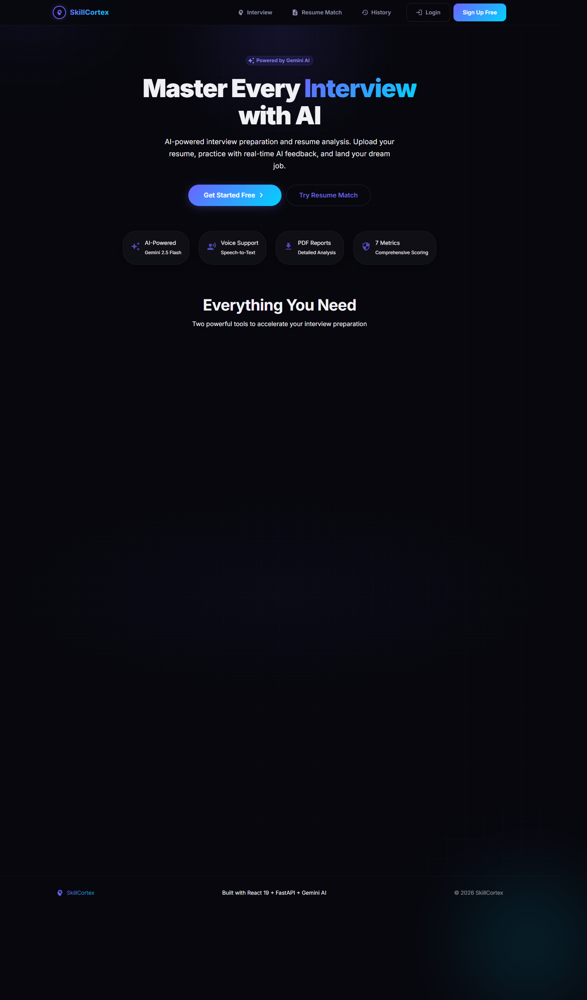
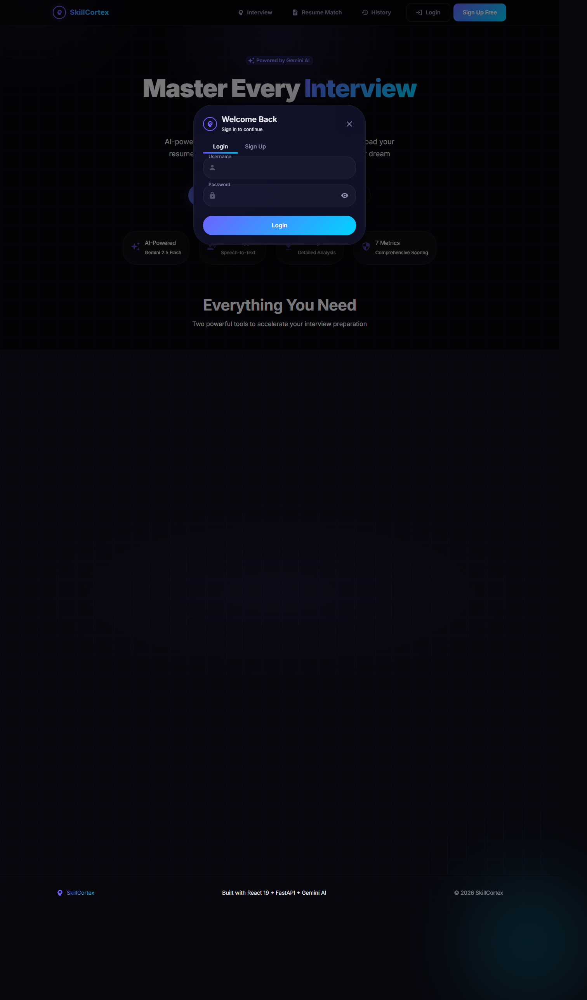

<div align="center">
  <br />
  
  <h1 align="center">HirePilot</h1>
  <p align="center">
    <strong>AI-Powered Interview Preparation &amp; Resume Analysis Platform</strong>
    <br />
    Master every interview with real-time AI feedback, resume matching, and personalized coaching.
  </p>

  <p>
    <a href="#-features"><strong>Features</strong></a> ·
    <a href="#-screenshots"><strong>Screenshots</strong></a> ·
    <a href="#-tech-stack"><strong>Tech Stack</strong></a> ·
    <a href="#-architecture"><strong>Architecture</strong></a> ·
    <a href="#-getting-started"><strong>Getting Started</strong></a> ·
    <a href="#-deployment"><strong>Deployment</strong></a> ·
    <a href="#-api-overview"><strong>API</strong></a>
  </p>

  <p>
    
    
    
    
    
    
    
  </p>
</div>

<br />

<!-- Add your demo video/gif here:
https://github.com/user-attachments/assets/your-video-id
-->

---

## ✨ Features

<div align="center">
  <table>
    <tr>
      <td align="center" width="33%">
        <h3>🎯 AI Mock Interviews</h3>
        <p>Gemini AI generates 10 personalized questions from your resume. Answer with text or voice and get scored across 7 dimensions.</p>
      </td>
      <td align="center" width="33%">
        <h3>📊 Real-Time Feedback</h3>
        <p>Get instant AI-powered evaluation after every answer — strengths, weaknesses, and actionable suggestions to improve.</p>
      </td>
      <td align="center" width="33%">
        <h3>📄 Resume Match (ATS)</h3>
        <p>Compare your resume against any job description. Get a match percentage, missing skills, and tailored improvement tips.</p>
      </td>
    </tr>
    <tr>
      <td align="center" width="33%">
        <h3>🔐 JWT Authentication</h3>
        <p>Secure signup/login with bcrypt password hashing, rate-limited endpoints, and persistent sessions via localStorage.</p>
      </td>
      <td align="center" width="33%">
        <h3>📈 Interview History</h3>
        <p>Track your progress over time. Review past interview sessions, scores, and feedback to measure improvement.</p>
      </td>
      <td align="center" width="33%">
        <h3>📑 PDF Reports</h3>
        <p>Download detailed interview performance reports with scores across all 7 metrics — perfect for tracking growth.</p>
      </td>
    </tr>
    <tr>
      <td align="center" width="33%">
        <h3>🎨 Modern Dark UI</h3>
        <p>Glassmorphism design with smooth Framer Motion animations, fully responsive, and accessible across all devices.</p>
      </td>
      <td align="center" width="33%">
        <h3>🎤 Voice Support</h3>
        <p>Speech-to-text for hands-free answering and text-to-speech for questions read aloud — immersive practice experience.</p>
      </td>
      <td align="center" width="33%">
        <h3>⚡ Fast & Lightweight</h3>
        <p>React 19 + Vite 8 frontend with FastAPI backend. Optimized bundle, lazy loading, and minimal latency.</p>
      </td>
    </tr>
  </table>
</div>

---

## 🖼️ Screenshots

<div align="center">
  <table>
    <tr>
      <td align="center">
        
        <br />
        <em>Landing Page — hero section with features</em>
      </td>
      <td align="center">
        
        <br />
        <em>Authentication — signup and login modal</em>
      </td>
    </tr>
    <tr>
      <td align="center">
        
        <br />
        <em>Interview — resume upload and question area</em>
      </td>
      <td align="center">
        
        <br />
        <em>Resume Match — ATS comparison analyzer</em>
      </td>
    </tr>
    <tr>
      <td align="center">
        
        <br />
        <em>History — past interview sessions overview</em>
      </td>
      <td align="center">
        <em>PDF Report — detailed performance report</em>
        <br />
        <em>(add a screenshot of the generated PDF)</em>
      </td>
    </tr>
  </table>
</div>

---

---

## 🛠️ Tech Stack

### Frontend

| Technology | Purpose |
|-----------|---------|
| **React 19** | UI framework |
| **Vite 8** | Build tool and development server |
| **Material UI 9** | Component library with custom dark theme |
| **Framer Motion** | Page transitions and micro-animations |
| **Axios** | HTTP client with JWT interceptor |
| **Recharts** | Score visualization and charts |
| **Web Speech API** | Voice recording and text-to-speech |

### Backend

| Technology | Purpose |
|-----------|---------|
| **Python 3.11+** | Runtime |
| **FastAPI** | High-performance async web framework |
| **SQLAlchemy** | ORM with SQLite / PostgreSQL support |
| **PyJWT** | JWT token generation and verification |
| **Passlib + bcrypt** | Password hashing |
| **Google Gemini AI** | Question generation and answer evaluation |
| **PyMuPDF** | PDF text extraction |
| **ReportLab** | PDF report generation |
| **SlowAPI** | Rate limiting |

### Deployment

| Service | Purpose |
|---------|---------|
| **Render** | Backend API hosting |
| **Vercel** | Frontend SPA hosting |

---

## 🏗️ Architecture

```
┌─────────────────────────────────────────────────────────┐
│                    Browser (User)                        │
│  ┌───────────────────────────────────────────────────┐  │
│  │              React SPA (Vite)                     │  │
│  │  ┌──────────┐  ┌──────────┐  ┌───────────────┐   │  │
│  │  │ Auth UI  │  │ Interview│  │ Resume Match  │   │  │
│  │  │ (JWT)    │  │   Page   │  │    Page       │   │  │
│  │  └────┬─────┘  └────┬─────┘  └───────┬───────┘   │  │
│  │       └─────────────┼─────────────────┘           │  │
│  │                     │ Axios + Bearer Token         │  │
│  └─────────────────────┼─────────────────────────────┘  │
└────────────────────────┼────────────────────────────────┘
                         │
                         ▼
┌─────────────────────────────────────────────────────────┐
│                  FastAPI Backend                         │
│  ┌──────────┐  ┌──────────┐  ┌──────────────────────┐  │
│  │ Auth     │  │ Resume   │  │  JWT Middleware       │  │
│  │ Routes   │  │ Routes   │  │  (Bearer Validation)  │  │
│  └────┬─────┘  └────┬─────┘  └──────────────────────┘  │
│       │             │                                    │
│       ▼             ▼                                    │
│  ┌──────────────────────────────────────────────────┐   │
│  │              Services Layer                       │   │
│  │  ┌──────────────┐  ┌─────────────────────────┐   │   │
│  │  │ AI Service   │  │ Resume Match Service    │   │   │
│  │  │ (Gemini API) │  │ (Gemini + PyMuPDF)      │   │   │
│  │  └──────┬───────┘  └─────────────────────────┘   │   │
│  │         │                                         │   │
│  │         ▼                                         │   │
│  │  ┌──────────────────────────────────────────┐    │   │
│  │  │         Google Gemini AI API              │    │   │
│  │  └──────────────────────────────────────────┘    │   │
│  └──────────────────────────────────────────────────┘   │
│                         │                                │
│                         ▼                                │
│  ┌──────────────────────────────────────────────────┐   │
│  │              SQLite / PostgreSQL                   │   │
│  │  ┌──────────┐  ┌──────────┐  ┌──────────────┐   │   │
│  │  │  Users   │  │ Sessions │  │    Feedback  │   │   │
│  │  └──────────┘  └──────────┘  └──────────────┘   │   │
│  └──────────────────────────────────────────────────┘   │
└─────────────────────────────────────────────────────────┘
```

### Authentication Flow

```
User → POST /api/auth/signup ──→ bcrypt hash password ──→ Store in DB
User → POST /api/auth/login  ──→ Verify password hash  ──→ Return JWT
User → [Protected Route]     ──→ Axios attaches Bearer ──→ FastAPI verifies JWT → Response
```

- JWT tokens are signed with HS256 using a configurable secret key
- Tokens expire after 24 hours (configurable via `JWT_EXPIRE_MINUTES`)
- All protected routes use `Depends(get_current_user)` FastAPI dependency
- Frontend Axios interceptor automatically attaches the Bearer token
- 401 responses trigger automatic logout via a custom window event

### Interview Workflow

```
1. Upload Resume (PDF) ──→ PyMuPDF extracts text
2. Gemini AI generates 10 personalized questions
3. Questions are loaded into a per-user session
4. User answers each question (text or voice)
5. Each answer is evaluated by Gemini AI across 7 metrics
6. Real-time scores and actionable feedback displayed
7. After all 10 questions → summary + downloadable PDF report
```

### Resume Match Workflow

```
1. Upload Resume (PDF) ──→ PyMuPDF extracts text
2. Paste job description ──→ Gemini AI compares both
3. Returns: match percentage, matched/missing skills, recommendations
```

---

## 🚀 Getting Started

### Prerequisites

- **Python 3.11+**
- **Node.js 18+**
- **Google Gemini API key** ([Get one free](https://aistudio.google.com/apikey))

### 1. Clone

```bash
git clone https://github.com/karthikJKST/AI-Career-Assistant.git
cd AI-Career-Assistant
```

### 2. Backend Setup

```bash
cd backend

# Create virtual environment
python -m venv venv

# Activate (Windows)
venv\Scripts\activate
# Activate (macOS/Linux)
# source venv/bin/activate

# Install dependencies
pip install -r requirements.txt
```

### 3. Configure Environment

Create `backend/.env`:

```env
GEMINI_API_KEY=your_gemini_api_key_here
JWT_SECRET_KEY=your_random_secret_key_here
JWT_EXPIRE_MINUTES=1440
HIREPILOT_ENV=development
```

> 💡 Setting `HIREPILOT_ENV=development` auto-creates a demo account:
> **Username:** `demo` · **Password:** `Demo@123`

### 4. Frontend Setup

```bash
cd frontend
npm install
```

Create `frontend/.env`:

```env
VITE_API_URL=http://127.0.0.1:8000/api
```

### 5. Run the Application

**Terminal 1 — Backend:**

```bash
cd backend
venv\Scripts\activate
python main.py
# → http://127.0.0.1:8000
```

**Terminal 2 — Frontend:**

```bash
cd frontend
npm run dev
# → http://localhost:5173
```

### 6. Try the Demo

1. Open **http://localhost:5173**
2. Click **Login** → **Sign Up** to create an account
3. Or use the demo account: `demo` / `Demo@123`
4. Upload a resume (PDF) and start practicing!

---

## 🚢 Deployment

### Backend (Render)

[](https://render.com/deploy)

| Setting | Value |
|---------|-------|
| **Runtime** | `Python 3.11` |
| **Build Command** | `pip install -r requirements.txt` |
| **Start Command** | `cd backend && uvicorn main:app --host 0.0.0.0 --port $PORT` |
| **Root Directory** | `AI-Career-Assistant/backend` |

**Required Environment Variables:**

| Variable | Description |
|----------|-------------|
| `GEMINI_API_KEY` | Your Google Gemini API key |
| `JWT_SECRET_KEY` | Strong random secret (`openssl rand -hex 32`) |
| `CORS_ORIGINS` | Your Vercel frontend URL |

### Frontend (Vercel)

[](https://vercel.com/new)

1. Import the `AI-Career-Assistant/frontend` directory
2. Vercel auto-detects Vite — no additional config needed
3. Set `VITE_API_URL` to your Render backend URL (e.g., `https://your-app.onrender.com/api`)

### Deployment Checklist

- [ ] `GEMINI_API_KEY` set on Render
- [ ] `JWT_SECRET_KEY` set to a strong random value on Render
- [ ] `CORS_ORIGINS` includes your Vercel frontend URL
- [ ] `VITE_API_URL` points to your Render backend URL
- [ ] Test: `GET https://your-app.onrender.com/health` → `{"status":"UP"}`
- [ ] Test: Full auth flow — register, login, upload resume, answer questions

---

## 📘 API Overview

All endpoints are prefixed with `/api`. Interactive docs at `/docs` (Swagger) or `/redoc` (ReDoc) when the backend is running.

| Method | Endpoint | Auth | Description |
|--------|----------|------|-------------|
| `GET` | `/health` | ❌ | Health check with database status |
| `POST` | `/api/auth/signup` | ❌ | Create a new account |
| `POST` | `/api/auth/login` | ❌ | Login, returns JWT token |
| `GET` | `/api/auth/me` | ✅ | Get current user profile |
| `POST` | `/api/upload-resume` | ✅ | Upload PDF resume, generate interview questions |
| `GET` | `/api/next-question` | ✅ | Get next interview question |
| `POST` | `/api/answer` | ✅ | Submit answer, receive AI evaluation and score |
| `GET` | `/api/download-report` | ✅ | Download PDF performance report |
| `GET` | `/api/history` | ✅ | View past interview sessions |
| `POST` | `/api/resume-match` | ✅ | Compare resume against job description |

### Scoring Metrics (1–10)

| Metric | Description |
|--------|-------------|
| Communication | Clarity, structure, articulation |
| Technical Knowledge | Depth of domain expertise |
| Confidence | Certainty in delivery |
| Grammar | Language correctness |
| Problem Solving | Analytical approach |
| Completeness | Coverage of the question |
| Professionalism | Tone and relevance |

---

## 🔒 Security

- **JWT Authentication** — Tokens signed with HS256, configurable expiry
- **Password Hashing** — bcrypt via Passlib (industry standard)
- **Rate Limiting** — Auth endpoints protected by SlowAPI
- **CORS** — Strict origin control via environment variable
- **Environment Variables** — All secrets isolated in `.env`, excluded from Git
- **Database** — SQLite excluded from version control
- **File Uploads** — Temporary directories, cleaned after processing

---

## 📁 Project Structure

```
AI-Career-Assistant/
├── backend/
│   ├── app/
│   │   ├── api/                  # Route handlers
│   │   │   ├── ai.py             # Interview Q&A endpoints
│   │   │   ├── auth_router.py    # Signup, login, /me
│   │   │   ├── history.py        # Session history
│   │   │   ├── resume.py         # Resume upload + question gen
│   │   │   └── resume_match.py   # Resume-JD matcher
│   │   ├── models/               # SQLAlchemy models
│   │   │   ├── interview.py
│   │   │   └── user.py
│   │   ├── services/             # Business logic
│   │   │   ├── ai_service.py
│   │   │   ├── pdf_service.py
│   │   │   ├── resume_match_service.py
│   │   │   └── resume_reader.py
│   │   ├── auth.py               # JWT utilities
│   │   ├── database.py           # DB connection
│   │   └── schemas.py            # Pydantic models
│   ├── main.py                   # FastAPI entry point
│   ├── runtime.txt               # Python version for Render
│   ├── requirements.txt
│   └── .env.example
├── frontend/
│   ├── public/
│   │   └── favicon.svg
│   ├── src/
│   │   ├── components/           # React components
│   │   │   ├── AuthModal.jsx
│   │   │   ├── FeedbackCard.jsx
│   │   │   ├── HistoryPage.jsx
│   │   │   ├── InterviewSection.jsx
│   │   │   ├── LoadingScreen.jsx
│   │   │   ├── ResumeMatch.jsx
│   │   │   ├── SummaryCard.jsx
│   │   │   ├── Timer.jsx
│   │   │   └── UploadSection.jsx
│   │   ├── context/              # React context
│   │   │   └── AuthContext.jsx
│   │   ├── services/             # API layer
│   │   │   └── api.js
│   │   ├── App.jsx               # Main application
│   │   └── main.jsx              # Entry point
│   ├── vercel.json               # SPA rewrites
│   ├── index.html
│   ├── package.json
│   └── .env.example
├── screenshots/                  # Screenshots for README
├── LICENSE                       # MIT License
├── .gitignore
└── README.md
```

---

## 🗺️ Future Roadmap

- [ ] **PostgreSQL Migration** — Production-ready database with connection pooling
- [ ] **OAuth Integration** — Sign in with Google, GitHub, LinkedIn
- [ ] **Team Mode** — Shared interview sessions for peer review
- [ ] **Real-Time Collaboration** — WebSocket-based live coaching
- [ ] **Custom Question Bank** — User-curated question collections
- [ ] **AI Resume Builder** — Generate optimized resumes for specific roles
- [ ] **Dashboard Analytics** — Visual progress tracking over time
- [ ] **Email Notifications** — Practice reminders and progress reports
- [ ] **Mobile App** — React Native or PWA for on-the-go practice
- [ ] **Multi-language Support** — Interview practice in multiple languages

---

## 🤝 Contributing

Contributions are welcome! Please follow these steps:

1. Fork the repository
2. Create a feature branch (`git checkout -b feature/AmazingFeature`)
3. Commit your changes (`git commit -m 'Add amazing feature'`)
4. Push to the branch (`git push origin feature/AmazingFeature`)
5. Open a Pull Request

### Development Guidelines

- Follow existing code style and conventions
- Add appropriate logging instead of `print()` statements
- Ensure all API changes are reflected in the endpoint table
- Test both frontend and backend before submitting

---

## 📄 License

Distributed under the **MIT License**. See [LICENSE](LICENSE) for more information.

---

## 👤 Author

**Karthik Shiva Teja**

- GitHub: [@karthikJKST](https://github.com/karthikJKST)
- LinkedIn: [Karthik Shiva Teja](https://linkedin.com/in/karthik-shiva-teja) <!-- Add your LinkedIn URL -->
- Project: [AI-Career-Assistant](https://github.com/karthikJKST/AI-Career-Assistant)

---

<div align="center">
  <sub>Built with React, FastAPI, and Google Gemini AI</sub>
</div>
